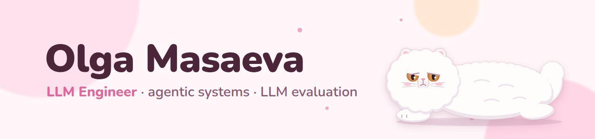

<picture>
  <source media="(prefers-color-scheme: dark)" srcset="assets/banner-dark.png">
  
</picture>

  
  
  

I build agentic and RAG systems and check that they actually work. For three years I have shipped LLMs to production in banking, ads and EdTech: GigaChat search and assistants at Sber, self-hosted Qwen pipelines and a profession recommender serving Moscow's employment centre. Most of my work is evaluation: LLM judges, red-teaming and statistics that hold up on small samples.

## Featured projects

<table>
<tr>
<td width="50%" valign="top">

**[paper-lab](https://github.com/olyamasaeva/paper-lab)** 
A Claude Code skill that turns a paper into a Jupyter assignment you have to solve: the core of the method is a stub, the tests check you against the paper's numbers. Evaluated against Yandex School of Data Analysis homework with an LLM judge that separates real gaps from deliberate omissions (7.44/10 on 8 topics).
</td>
<td width="50%" valign="top">

**[book-translate](https://github.com/olyamasaeva/book-translate)** 
A Claude Code skill that translates scanned books in place. Photos and sewing patterns stay uncovered; the output is an in-place PDF, a bilingual PDF and an offline reader with sentence-level alignment. Built on a 222-page Finnish book about folk costume.
</td>
</tr>
<tr>
<td width="50%" valign="top">

**[ru-genealogy-search](https://github.com/olyamasaeva/ru-genealogy-search)** 
An agent skill that finds ancestors in Russian and Soviet records that search engines miss: the notary inheritance registry, Leningrad evacuation lists, repression memory books, WWII losses. It builds a GEDCOM tree with a source and a confidence level for every fact.
</td>
<td width="50%" valign="top">

**[video-kb](https://github.com/olyamasaeva/video-kb)** 
A Claude Code skill that turns a YouTube course into a knowledge base of practice cards with honest limits and lecture summaries with clickable timecodes. Auto-subtitles are fixed by counted TSV rules, not rewritten by a model, and every quote and timecode is checked by scripts: on Stanford CS329Z, 93 cards and 4060 timecodes with 0 verify errors.
</td>
</tr>
</table>

## Work

- **Sea of Data** · LLM / AI Engineer · 2025–now. EdTech startup, AI career guidance for schools, universities and employment centres. Evaluation of a production AI tutor: a self-hosted Qwen judge scored 1,245 tutor turns on 18 pedagogical dimensions against 262 lessons of award-winning teachers. A profession recommender and learning-path builder in production for 3,600+ users, Moscow Employment Centre and Moscow Polytech. LLM skill extraction from 61M job postings into 22K canonical skills (F1 0.859 → 0.912).
- **Sber** · LLM Engineer · 2024–2025. Designed and shipped conversational AI digital twins, still in production: a ReAct orchestrator over platform APIs, RAG over categorised facts with hybrid search, our own schema-constrained generation on beam search before GigaChat had structured outputs, and a LoRA-tuned GigaChat for the person's style, served on SGLang and llama.cpp. RAG assistants for finance and insurance with OCR/VLM document parsing; GigaChat query understanding for restaurant search; adapted RAGAS to Russian for LLM-as-a-Judge evaluation.
- **Yandex** · ML Intern, Ads · 2023. Debugging tools for the ad-load model; a CatBoost sample-reweighting experiment with an online A/B test.

## Talks and writing

- **AI tutor and its evaluation methods** · Data Fest 2026 · [video](https://www.youtube.com/watch?v=obeNjEOnG84)
- **Automatic RAG evaluation systems review** · Data Fest 2024 · [video](https://www.youtube.com/watch?v=VcOLsc1MUTY)
- **Tune in to RAGAS and customize RAGAS for yourself** · Habr, Sber blog, 2024 · [article](https://habr.com/ru/companies/sberbank/articles/831346/)

## Toolbox

Python · PyTorch · Hugging Face · LoRA / PEFT · LangGraph · RAG · Qdrant · vLLM · SGLang · Qwen · GigaChat · Claude Code · FastAPI · Docker · DuckDB · MLflow · DVC

ACM ICPC semi-finalist, informatics olympiad coach.
